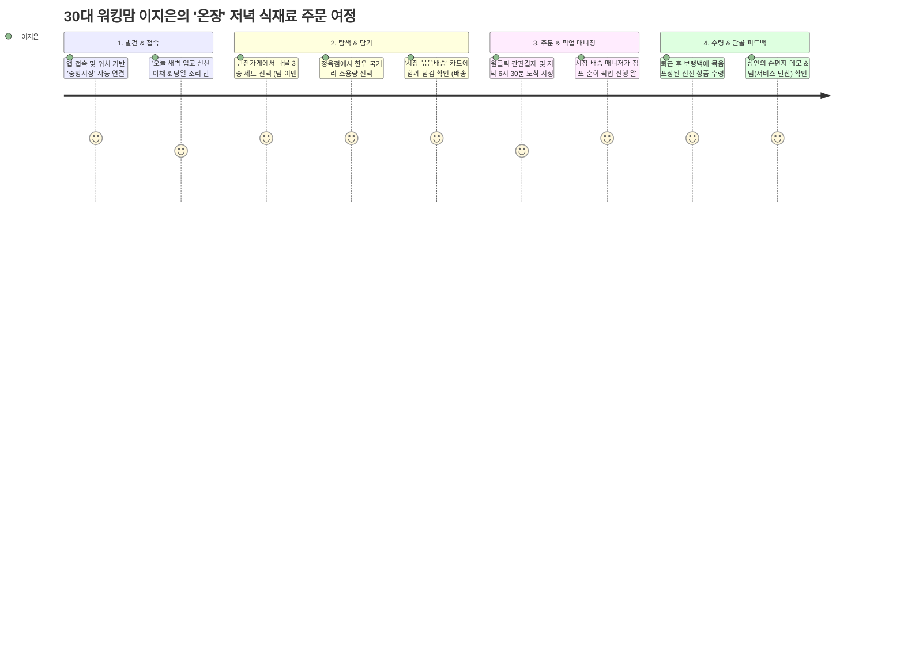

# 🌿 전통시장·로컬 커머스 앱 리디자인 & UX/UI 디자인 가이드

> **서비스명 가칭**: **온장 (溫場, On-Jang)** - *‘따뜻한 온기와 정(情)이 깃든 우리 동네 손안의 전통시장’*

---

## 1. 프로젝트 개요 및 리디자인 전략

### 1.1. 기존 전통시장 커머스 앱의 주요 페인포인트
1. **점포별 파편화된 배송**: 시장 안 여러 가게에서 살 때 배송비가 중복 부과되거나 수령 시간이 제각각임.
2. **신선도 및 품질에 대한 불안**: 오프라인에서 직접 눈으로 보고 사던 신선식품의 선도 확인 불가.
3. **복잡한 탐색 경험**: 카테고리 분류가 모호하고 검색이 비직관적이며, 시니어/초보 사용자 접근성 부족.
4. **전통시장 고유 매력의 부재**: '덤 문화', '상인과의 소통', '활기찬 골목 분위기'가 디지털에서 사라짐.

### 1.2. 리디자인 핵심 가치 (Design Pillars)
- **통합 묶음배송 (One-Cart Unified Delivery)**: 시장 내 여러 점포의 상품을 하나의 장바구니에 담아 2~3시간 내 당일 통합 배송.
- **온기 있는 투명성 (Warm Transparency)**: 상인의 당일 입고 숏폼/라이브 영상 및 '오늘의 신선도 지수' 제공.
- **정(情)과 단골 인터랙션 (Local Loyalty & Bonus)**: 디지털 '덤(Bonus)' 쿠폰 및 단골 상인 감사 메시지 시스템.
- **이지-모드 & 직관적 UI (Universal Accessibility)**: 고령층도 쉽게 쓸 수 있는 큼직한 타이포와 간결한 주문 경로.

---

## 2. 사용자 페르소나 및 시나리오

### 2.1. 핵심 페르소나

#### [페르소나 1] 30대 중반 워킹맘 · 이지은 (35세)
- **직업/환경**: 대기업 과장, 초등학생 자녀 1명, 경기 성남 거주
- **목표**: 퇴근 후 아이에게 신선하고 건강한 당일 산지 직송 식재료와 반찬을 먹이고 싶음.
- **니즈**: 
  - 퇴근 시간에 맞춰 전통시장의 싱싱한 채소/과일/반찬을 묶음 배송으로 수령.
  - 마트 공산품 대비 품질과 원산지에 대한 명확한 신뢰.
- **페인포인트**: 퇴근 후 시장 갈 시간이 없고, 기존 앱은 반찬가게와 정육점 배송비가 따로 붙어 불편함.

#### [페르소나 2] 20대 후반 1인 가구 자취생 · 김민우 (28세)
- **직업/환경**: 스타트업 디자이너, 1인 가구, 서울 마포구 거주
- **목표**: 1인분 맞춤형 가성비 반찬, 시장 분식/먹거리 밀키트를 간편하게 즐김.
- **니즈**:
  - 소용량(소포장) 식재료 및 완성형 안주/밀키트 탐색.
  - 시장 맛집 랭킹 및 숏폼 기반의 음식 리뷰.
- **페인포인트**: 전통시장은 대용량 판매가 많아 음식물 쓰레기 부담, 결제/주문 UI가 복잡하면 이탈.

#### [페르소나 3] 60대 전통시장 상인 · 박영순 (62세, 반찬가게 18년 차)
- **직업/환경**: 중앙시장 반찬가게 운영, 스마트폰 기본 기능만 활용
- **목표**: 단골 관리 및 비수기 매출 증대, 복잡한 전산 작업 없이 간편하게 주문 확인.
- **니즈**:
  - 큰 글씨와 음성 알림으로 들어오는 주문 확인.
  - 원클릭 품절 처리 및 오늘의 추천 메뉴 등록 기능.

---

### 2.2. 사용자 여정 시나리오 (User Journey)



---

## 3. 정보 구조도 (IA) & 핵심 화면 와이어프레임

### 3.1. 정보 구조도 (Information Architecture)

```
온장 (Root)
├── 1. 홈 (Home)
│   ├── 내 위치 / 단골 전통시장 선택
│   ├── 오늘 입고된 신선 특가 (타임세일)
│   ├── 시장 골목 숏폼 & 실시간 라이브 ("지금 떡 찌는 중!")
│   ├── 테마별 장보기 (오늘 저녁 뭐 먹지 / 1인 가구 소포장 / 명절 특선)
│   └── 시장 상인 추천 맛집 랭킹
├── 2. 장보기 (Market Category)
│   ├── 카테고리별 (채소/과일/정육/수산/반찬/분식/건어물)
│   ├── 시장 지도 뷰 (Virtual Market Alley Tour)
│   └── 상점별 상세페이지 (대표 메뉴, 신선도 인증, 단골 혜택)
├── 3. 동네소식/스토리 (Community)
│   ├── 시장 상인들의 오늘 이야기 (입고 소식, 덤 소식)
│   ├── 이웃들의 시장 레시피 & 구매 후기
│   └── 전통시장 장날/축제/온누리상품권 행사 안내
├── 4. 묶음 장바구니 (Unified Cart)
│   ├── 상점별 담은 품목 그룹화 (단일 배송비 적용)
│   ├── 묶음배송 무료 배송비 달성 게이지
│   ├── 단골 '덤(Bonus)' 선택권 적용
│   └── 배송 시간 슬롯 선택 (당일 2시간 특급 / 예약 배송)
└── 5. 마이페이지 (My Page)
    ├── 배송 라이브 트래킹 (매니저 픽업 상태)
    ├── 나의 단골 상점 & 받은 덤 모아보기
    ├── 모바일 온누리상품권 / 지역화폐 연동 관리
    └── 간편 모드(큰 글씨) 전환 토글
```

---

### 3.2. 핵심 화면 UX 와이어프레임 (Wireframes)

#### [Screen 1: 메인 홈 화면 (Main Home)]
```
+---------------------------------------------------+
| [ 📍 마포 망원시장 ▼ ]             [🔍] [🔔] [🛒 3] |
+---------------------------------------------------+
| [배너] 오늘 저녁 7시 전 도착! 시장 묶음배송 OPEN     |
|       "3만원 이상 구매 시 시장 장바구니 증정"     |
+---------------------------------------------------+
| [카테고리 퀵메뉴]                                 |
| (🥬 채소)  (🍎 과일)  (🥩 정육)  (🐟 수산)  (🍱 반찬) |
| (🍢 분식)  (🥜 견과)  (🏪 1인용) (🔥 덤특가) (🗺️ 지도) |
+---------------------------------------------------+
| 🔴 [상인 라이브 숏폼] "방금 부친 빈대떡 바삭해요!" |
| +-------+  +-------+  +-------+  +-------+        |
| |[영상1]|  |[영상2]|  |[영상3]|  |[영상4]|        |
| |원조전집|  |영순반찬|  |신선정육|  |바다수산|        |
| +-------+  +-------+  +-------+  +-------+        |
+---------------------------------------------------+
| ⚡ [오늘의 마감 임박 신선 특가]                   |
| ┌───────────────────────────────────────────────┐ |
| │ [이미지] 달콤한 성주참외 1봉 (5개)  [담기 +]   │ |
| │          망원청과  35% 8,900원  ~~13,800원~~   │ |
| └───────────────────────────────────────────────┘ |
+---------------------------------------------------+
| [ 🏠 홈 ]  [ 🛍️ 장보기 ]  [ 📰 동네 ]  [ 👤 MY ]  |
+---------------------------------------------------+
```

#### [Screen 2: 시장 묶음 장바구니 (Unified Cart)]
```
+---------------------------------------------------+
| [< 뒤로]             장바구니 (3개 점포)           |
+---------------------------------------------------+
| 🚚 [망원시장 묶음배송]                              |
| [====================        ] 21,500원 / 30,000원 |
| 💡 8,500원 더 담으면 배송비 무료!                 |
+---------------------------------------------------+
| [v] [영순이네 반찬]                               |
|   - 깻잎장아찌 200g (1개)               4,500원   |
|   - 달래된장찌개 밀키트 (1개)           7,000원   |
|   🎁 단골 덤 혜택: 콩자반 50g 무료 증정           |
+---------------------------------------------------+
| [v] [마포축산]                                    |
|   - 한우 국거리 1++ (300g)             10,000원   |
+---------------------------------------------------+
| 🕒 도착 예정 시간 선택                            |
| (o) 오늘 18:30~19:30 도착   ( ) 내일 오전 08:00   |
+---------------------------------------------------+
| 총 결제금액: 21,500원 + 배송비 3,000원 = 24,500원 |
| [ 24,500원 묶음배송 주문하기 (온누리 10% 할인) ]  |
+---------------------------------------------------+
```

#### [Screen 3: '온기 덤(Bonus)' 선택 인터랙션]
```
+---------------------------------------------------+
|                 🎁 상인의 정(情) 선물              |
|        "영순이네 반찬에서 덤을 골라주세요!"        |
+---------------------------------------------------+
| 고객님, 오늘도 찾아주셔서 감사해요!               |
| 오늘 갓 만든 반찬 중 하나를 맛보기로 얹어드려요.  |
|                                                   |
|  (o) [고소한 멸치볶음 50g]                         |
|  ( ) [아삭한 깍두기 3조각]                         |
|  ( ) [상인님께 따뜻한 응원 메시지만 보내기]       |
|                                                   |
| [ 상인님께 한마디: "지난번 된장국 너무 맛있었어요!" ] |
+---------------------------------------------------+
|               [ 덤 담고 장바구니 가기 ]            |
+---------------------------------------------------+
```

---

## 4. 앱 디자인 시스템 (Design System & Specs)

### 4.1. 브랜드 및 무드
- **디자인 키워드**: `Warm Organic`, `Modern Folk`, `Crisp Freshness`, `Approachable`
- **시각적 방향성**: 전통시장의 따뜻한 주황색 불빛과 신선한 자연의 초록색을 모던하고 정갈한 플랫/글래스모피즘과 조합.

### 4.2. 컬러 팔레트 (Color Palette)

| 토큰명 | Hex Code | 역할 및 사용처 |
| :--- | :--- | :--- |
| **Primary (Market Warmth)** | `#FF6B35` | 브랜드 주색상, CTA 버튼, 특가 강조, 활기 |
| **Primary Light** | `#FFF0EB` | 태그 배경, 선택된 탭, 하이라이트 박스 |
| **Secondary (Fresh Local)**| `#2D6A4F` | 신선식품(친환경/당일입고), 원산지 인증 배지 |
| **Secondary Light** | `#E8F5E9` | 친환경/신선도 배지 배경 |
| **Accent (Bonus Yellow)**  | `#FFB703` | 덤(Bonus) 쿠폰, 리뷰 별점, 스페셜 이벤트 |
| **Neutral Dark** | `#1A1D20` | 헤드라인 텍스트, 아이콘 기본색 |
| **Neutral Gray (Body)** | `#555B62` | 본문 설명, 보조 텍스트 |
| **Neutral Line** | `#E9ECEF` | 디바이더, 카드 테두리 |
| **Surface/Card** | `#FFFFFF` | 카드 배경, 모달 배경 |
| **Background (Warm Gray)** | `#F8F9FA` | 앱 전체 배경 |

### 4.3. 타이포그래피 (Typography Hierarchy)

- **국문/숫자 메인 폰트**: `Pretendard` (가독성과 숫자 정렬 우수)
- **포인트/헤드라인 폰트**: `Gmarket Sans` (전통의 친근함과 현대적 굵기 강조)

| 레벨 | 폰트 / 두께 | 크기 / 행간 | 용도 |
| :--- | :--- | :--- | :--- |
| **Display 1** | Gmarket Sans Bold | 26px / 34px | 메인 프로모션 헤드라인, 온기 메시지 |
| **Heading 1** | Pretendard Bold | 20px / 28px | 섹션 타이틀, 상점명, 결제 최종 금액 |
| **Heading 2** | Pretendard SemiBold | 17px / 24px | 상품명, 탭 메뉴, 팝업 타이틀 |
| **Body 1** | Pretendard Regular | 15px / 22px | 상품 설명, 배송 안내, 일반 본문 |
| **Body 2 (Caption)**| Pretendard Medium | 13px / 18px | 상인 메모, 원산지, 부가 설명 |
| **Micro** | Pretendard Regular | 11px / 14px | 배지 텍스트, 타임스탬프 |

### 4.4. UI 컴포넌트 규격 및 인터랙션 가이드
1. **버튼 (CTA Button)**:
   - 높이 54px, `border-radius: 14px`, 폰트 16px SemiBold.
   - 탭 시 0.98 scale 마이크로 인터랙션과 함께 햅틱 피드백 적용.
2. **상품 카드 (Product Card)**:
   - `border-radius: 16px`, `box-shadow: 0 4px 16px rgba(0,0,0,0.04)`.
   - 신선도 뱃지 (`#2D6A4F`) + '오늘 입고' 라벨 기본 노출.
   - '+' 버튼 터치 시 장바구니 탭 아이콘으로 부드럽게 날아가는 패스 애니메이션.
3. **상인 스토리 링 (Story Ring)**:
   - 인스타그램 스토리 스타일의 상인 프로필 링 (Live 중일 때 `#FF6B35` 펄스 애니메이션).

---

## 5. AI 프롬프트 가이드 (AI Prompt Guide)

프로젝트 디자인, 고품질 이미지 생성, 상인 홍보 문구 작성에 즉시 복사하여 사용할 수 있는 프롬프트 모음입니다.

### 5.1. UI/UX 목업 생성용 프롬프트 (Midjourney v6 / 이미지 생성 AI)

#### [프롬프트 1: 메인 홈 화면 및 마켓 플레이스 UI]
```text
Clean and modern mobile app UI design for a Korean traditional local market grocery delivery app called "On-Jang", iOS 17 style, warm orange (#FF6B35) and fresh green (#2D6A4F) accent colors, white minimalist card layout, displaying fresh Korean produce, homemade side dishes (banchan), friendly merchant live stories at the top, bundled cart status bar, high-resolution Figma mockup, Dribbble trending, ultra-detailed, 8k --ar 9:16 --v 6.0
```

#### [프롬프트 2: 묶음배송 장바구니 & 덤(Bonus) 선물 인터랙션]
```text
Mobile app UI checkout and bundled cart screen for traditional market e-commerce, showing multiple stalls consolidated into one order, interactive bonus gift "Deom" selection modal popup with warm illustrations, friendly Korean typography, soft rounded glassmorphism cards, pastel tones with vibrant orange CTA button, sleek and clean UX, Behance award-winning UI/UX --ar 9:16 --v 6.0
```

---

### 5.2. 상점 대표 및 상품 비주얼 생성용 프롬프트

#### [프롬프트 3: 현대적으로 재해석된 전통시장 골목 전경]
```text
A vibrant and heartwarming Korean traditional market alley in Seoul at golden hour, beautifully organized stalls with fresh colorful vegetables, artisanal side dishes in neat glass cases, warm hanging lantern lights, clean floor, lively atmosphere, cinematic lighting, photorealistic, shot on Sony A7R V, 35mm f/1.8 lens, 8k resolution --ar 16:9 --style raw
```

#### [프롬프트 4: 전통시장 당일 수제 반찬 세트 컷]
```text
Top-down flatlay photo of fresh authentic Korean side dishes (banchan) in eco-friendly packaging, seasoned perilla leaves, stir-fried anchovies, kimchi, and seasoned namul herbs, placed on a warm wooden dining table with a linen cloth, soft natural morning sunlight, cozy homestyle aesthetic, editorial food photography --ar 4:3 --v 6.0
```

---

### 5.3. 상인 상세페이지 & 마케팅 카피라이팅 프롬프트 (ChatGPT / Claude용)

#### [프롬프트 5: 60대 반찬가게 사장님 톤의 정겨운 스토리 카피]
```text
[역할]: 당신은 망원시장에서 20년 동안 매일 아침 손수 반찬을 만드는 '영순이네 반찬'의 박영순 사장님입니다.
[목표]: 로컬 커머스 앱 '온장'에 등록할 반찬가게 소개글과 오늘의 대표 메뉴(달래된장찌개 밀키트, 계절 나물 3종)의 상세 홍보 문구를 작성해주세요.
[톤앤매너]:
1. 어머니의 따뜻한 정(情)과 깊은 손맛이 느껴지는 다정하고 신뢰감 있는 말투.
2. "새벽 가락시장에서 직접 떼온", "우리 가족이 먹는다는 마음으로" 같은 생생한 디테일 포함.
3. 구매 고객에게 무료로 증정하는 '오늘의 덤(콩자반)'에 대한 감사의 말 추가.
[출력 형식]:
- 가게 한 줄 소개
- 사장님의 인사말 (3~4문장)
- 오늘의 추천 반찬 3종 (메뉴명 / 특징 / 맛있게 먹는 꿀팁)
- 덤(Bonus) 선물 안내
```

#### [프롬프트 6: 2030 1인 가구 타겟 장보기 푸시 알림 카피 5종]
```text
[목표]: 전통시장 로컬 커머스 앱 '온장'의 2030 직장인 및 1인 가구 대상 저녁 묶음배송 유도 푸시 알림 문구 5개를 작성해주세요.
[조건]:
- 글자 수: 제목(20자 이내), 내용(45자 이내)
- 이모지 적극 활용
- 혜택(당일 퇴근 전 도착, 배송비 0원 묶음배송, 1인용 소포장 맛집)을 명확히 전달할 것
- A/B 테스트가 가능하도록 감성형, 혜택형, 위트형, 긴급형(타임세일) 버전으로 다변화할 것.
```

---

## 6. 구현 및 배포 체크리스트 (UX/UI Checklist)

- [ ] **접근성 (Accessibility)**: 시니어 모드 활성화 시 폰트 크기 120% 확대 및 대비율 4.5:1 준수
- [ ] **묶음배송 UX**: 서로 다른 점포의 상품이 담겼을 때 배송비 계산 방식이 명확히 인지되는가?
- [ ] **실시간성 알림**: 상인의 주문 접수, 배송 매니저의 픽업 현황이 단계별(3단계)로 푸시되는가?
- [ ] **결제 수단 연동**: 모바일 온누리상품권(10% 할인), 제로페이, 네이버페이, 카카오페이 지원
